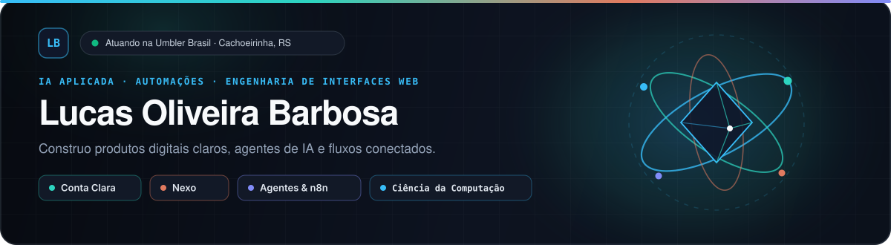
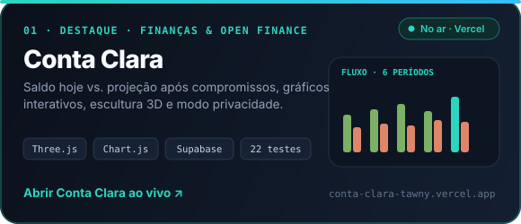
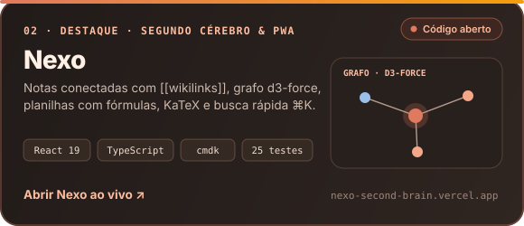

<a href="https://lucas-barbosa-portfolio.vercel.app">
  <picture>
    <source media="(prefers-color-scheme: dark)" srcset="./assets/hero-dark.svg" />
    <source media="(prefers-color-scheme: light)" srcset="./assets/hero-light.svg" />
    
  </picture>
</a>

  

 

## 🚀 Projetos em destaque

  
  

 

| Projeto | Foco & Arquitetura | Acesso |
| :--- | :--- | :--- |
| **🟢 Conta Clara** | Painel pessoal de fluxo de caixa com Open Finance, gráficos em `Chart.js`, escultura orbital `Three.js`, modo privacidade e `Supabase RLS` | [Abrir app ↗](https://conta-clara-tawny.vercel.app) · *código privado* |
| **🟠 Nexo** | Segundo cérebro editorial com `[[wikilinks]]`, grafo interativo `d3-force`, planilhas com fórmulas, `KaTeX`, paleta `⌘K` e `PWA` offline | [Abrir app ↗](https://nexo-second-brain.vercel.app) · [Código ↗](https://github.com/Lucas-Barbosa-Oli/nexo) |
| **🟣 Arch Atlas AI** | Guia interativo em `Next.js` de System Design, Design Patterns, RAG, AI Agents e Agent Harness | [Abrir app ↗](https://arch-atlas-ai.vercel.app) |
| **🔵 Telegram Finance Bot** | Bot conversacional em `Python` + `IA` + `APIs` para registrar receitas/gastos e gerar gráficos mensais no Telegram | [Código ↗](https://github.com/Lucas-Barbosa-Oli/telegram-finance-bot) |
| **✨ Portfólio Pessoal** | Experiência interativa em `Next.js 15`, `Three.js`, `Motion` e `Lenis` com vitrine horizontal guiada pela rolagem | [Abrir site ↗](https://lucas-barbosa-portfolio.vercel.app) · [Código ↗](https://github.com/Lucas-Barbosa-Oli/lucas-barbosa-portfolio) |

## 🧠 Stack & Áreas de atuação

 

| Pilar | O que construo no dia a dia |
| :--- | :--- |
| **🤖 IA Aplicada & Agentes** | Chatbots, agentes de IA personalizados, RAG e fluxos conversacionais voltados à operação real |
| **⚡ Automações & APIs** | Orquestração com **n8n**, **Make**, webhooks, integrações **REST** e bancos com **Supabase** |
| **🎨 Produtos Web & UI/UX** | Aplicações em **React / Next.js**, **TypeScript**, visualização de dados (**Chart.js / d3-force**) e **Three.js** |
| **🔬 Pesquisa & Formação** | **Ciência da Computação no Cesuca** (2027/2) · Pesquisador em IA no **Cesuca Code** |

## 🧭 Trajetória

- **Umbler Brasil** · *Implantação de Soluções Tecnológicas e Inteligência Artificial* (`Fev 2026 — Atual`)  
  Levantamento de requisitos, desenvolvimento de chatbots e agentes de IA, automações em n8n/Make, integrações via APIs REST e validação de fluxos com clientes.
- **Cesuca Code** · *Pesquisa e Desenvolvimento em IA* (`Em andamento`)  
  Solução colaborativa de IA para apoiar estudantes de Ciência da Computação e ADS, orientada por revisão sistemática da literatura.
- **Cesuca** · *Bolsista Voluntário em Pesquisa Python* (`Mar — Dez 2024`)  
  Interface em Python de visualização em tempo real para sistema de medição de temperatura, testes de interação e validação de dados.
- **Formação & Idiomas** · Bacharelado em Ciência da Computação (Cesuca, conclusão 2027/2) · Português nativo · Inglês fluente.

<strong>🌐 English overview</strong>

 

I work on **AI & technology solution implementation at Umbler Brasil** and study **Computer Science at Cesuca** (expected late 2027), building AI agents, workflow automations (**n8n**, **Make**, **REST APIs**), and crafted web products like **[Conta Clara](https://conta-clara-tawny.vercel.app)** and **[Nexo](https://nexo-second-brain.vercel.app)**.

Explore the full interactive version at **[lucas-barbosa-portfolio.vercel.app](https://lucas-barbosa-portfolio.vercel.app)**.

 

  Feito na mesma identidade visual do meu <a href="https://lucas-barbosa-portfolio.vercel.app"><strong>Portfólio Interativo</strong></a> · Vamos conversar no <a href="https://www.linkedin.com/in/lucas-oliveira-barbosa-b37a5626a/"><strong>LinkedIn</strong></a>!

